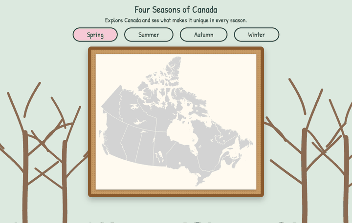
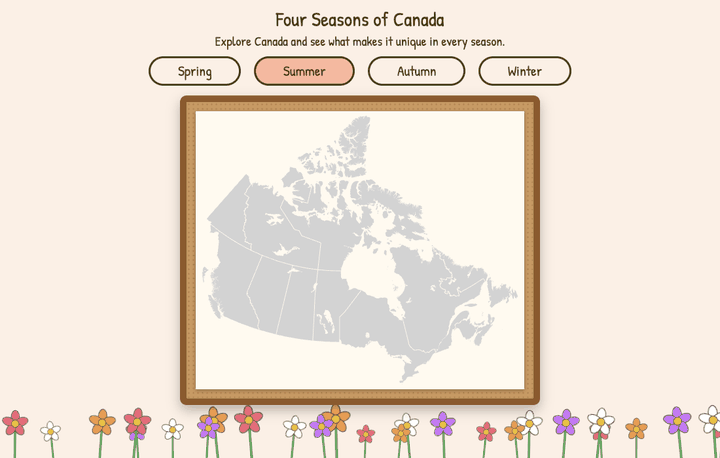
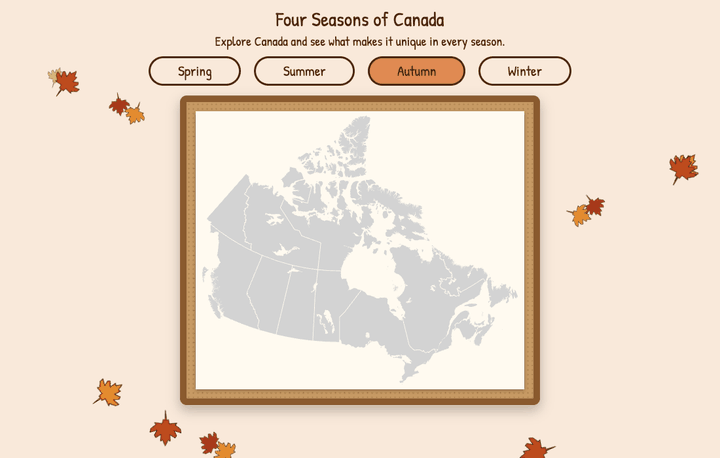
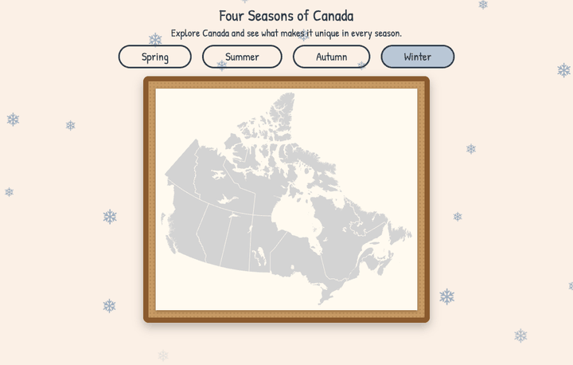

# Four Seasons of Canada

A small interactive page that teaches the four seasons through a bulletin-board map of Canada. Pick a season and the whole page transforms; thumbtacks fly onto the map, and hovering or clicking one shows what is unique to Canada in that season.

| Spring | Summer |
| :---: | :---: |
|  |  |
| **Autumn** | **Winter** |
|  |  |

## The app is simple. The process is the point.

This project was built end to end with an **AI agentic workflow** using **spec-driven development**: the AI agent (Claude Code) doesn't start by writing code. A human-led planning conversation comes first, and every stage produces a written document the next stage builds on.

| Stage | Skill | Output |
| --- | --- | --- |
| Start | `1-start` | Learner profile |
| Scope | `2-scope` | [`specs/scope.md`](specs/scope.md): the idea cut down to a proof of concept |
| Product definition | `3-prd` | [`specs/prd.md`](specs/prd.md): behaviors, states, edge cases |
| Technical blueprint | `4-spec` | [`specs/spec.md`](specs/spec.md): stack, components, data, file structure |
| Build | `5-build` | [`specs/checklist.md`](specs/checklist.md): six small slices, each verified and committed |
| Wrap-up | `5-build` | [`specs/app-map.html`](specs/app-map.html): a map of the finished code |
| Ship | `6-ship` | Verified build, this README, the repo |

How it worked in practice:

- **The human decides, the agent interviews.** The skills ask questions one at a time instead of generating a plan unprompted.
- **Plan before code.** The scope, PRD and spec were each approved before any code existed.
- **Small verified slices.** Each build slice was checked mechanically (build, DOM checks) and by hand, then committed.
- **Choose your pace.** The build stage offers a learn mode and a fast mode. This project started in learn mode and switched to fast after slice 2.
- **Feedback changes the plan, on the record.** Revisions are logged in the checklist.

## The skill pack

The skills that drove this build are in [`.claude/skills/`](.claude/skills/). They are plain Markdown instructions, and they work like this:

- **Learn while you build.** You say what you want to learn and which skills you want to grow, and the agent adapts to your level.
- **Start with a small proof of concept.** One idea, one core feature, planned before any code.
- **You choose how involved the AI is.** From the agent writing the code (with or without explanations) to you writing it with the agent as a mentor.
- **You choose what happens next.** Keep building, publish on GitHub, prepare a hackathon submission, or something else.

Their working folder is [`specs/`](specs/).

Standalone skill pack repo: _link coming soon_

## Run it

Needs a current Node.js LTS.

```
npm install
npm run dev
```

Open the address it prints (usually http://localhost:5173). Desktop browser with a mouse; nothing is saved and there is no server.

Built with React, TypeScript and Vite. Content lives in `src/data/seasons.ts`.

## Credits

Pictures and the map come from Wikimedia Commons; see [`public/images/SOURCES.md`](public/images/SOURCES.md) for each file's page and licence.
